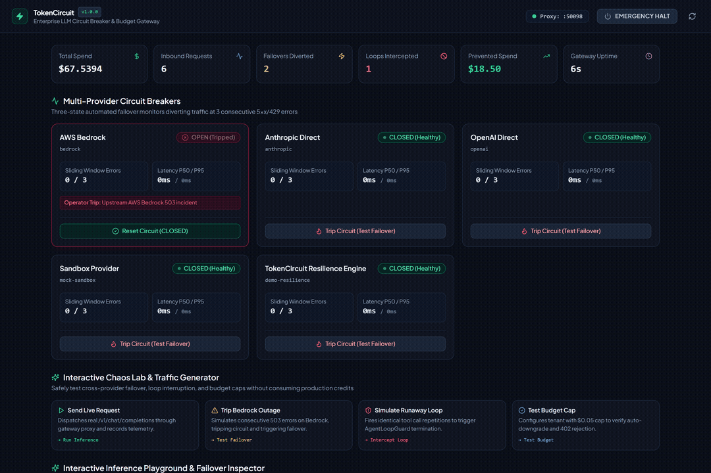
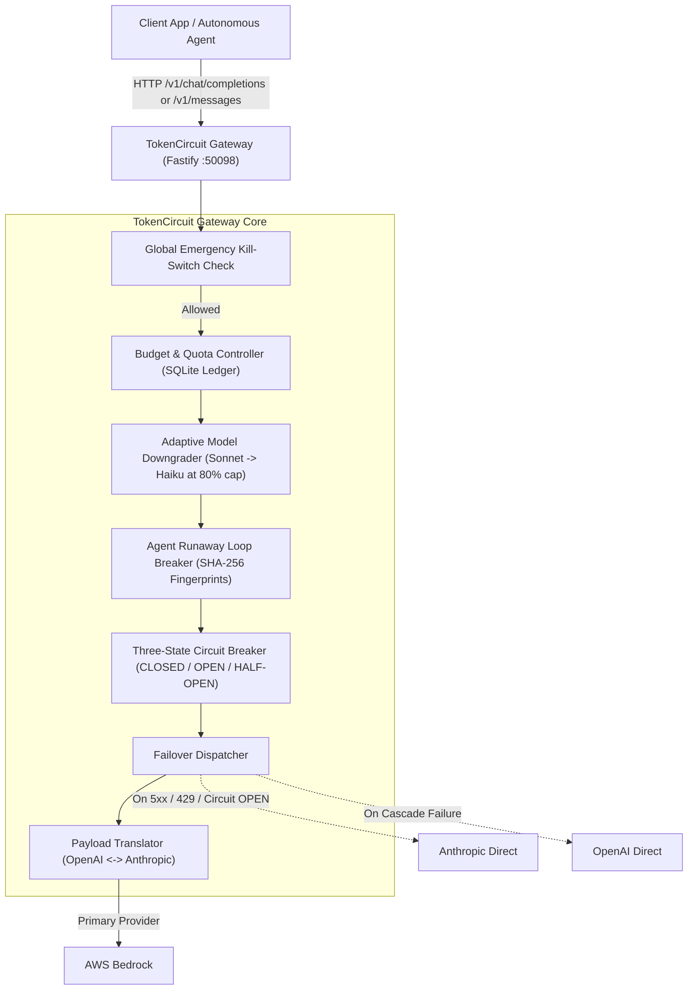
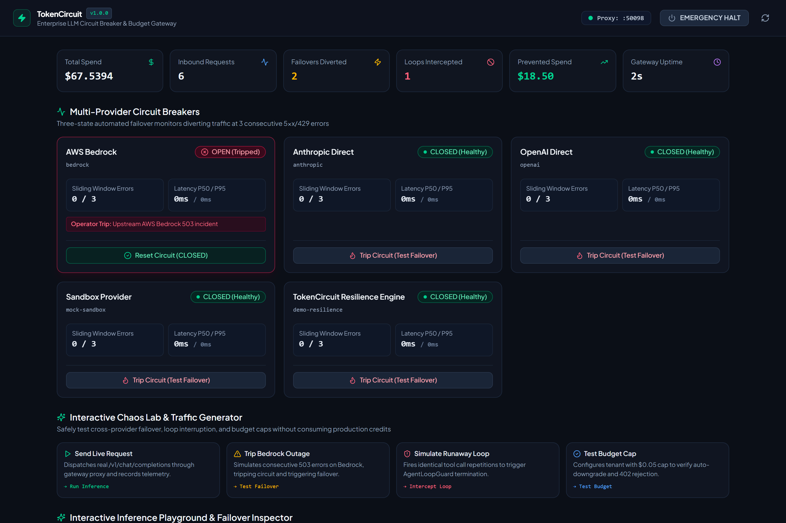
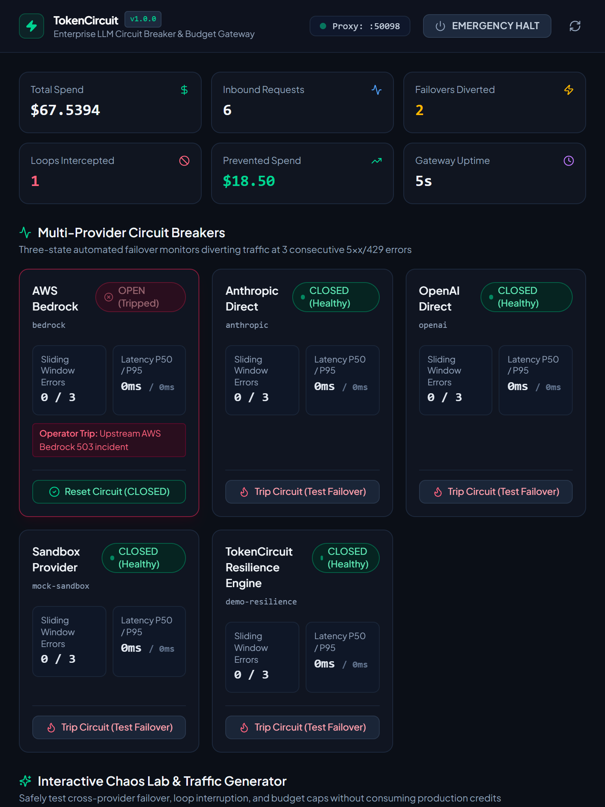
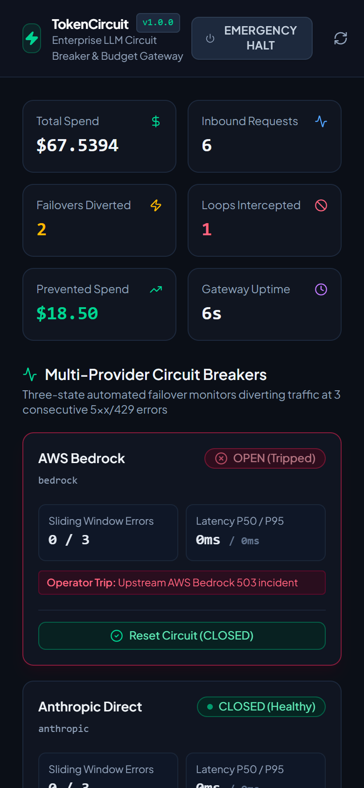
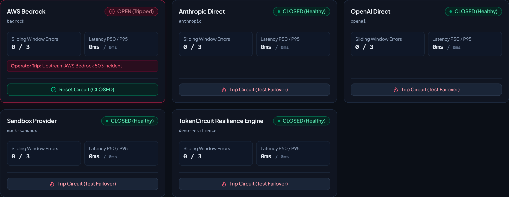
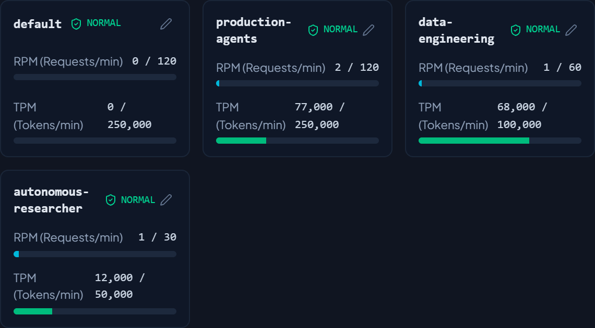
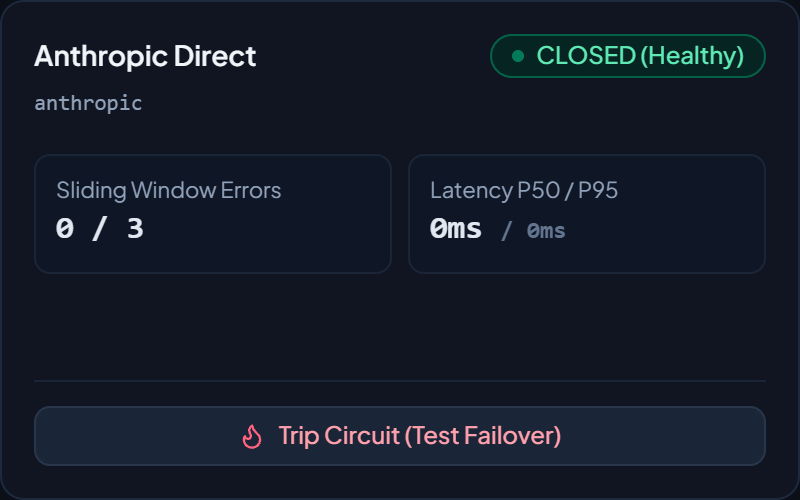
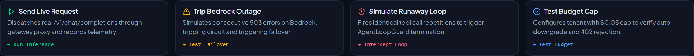
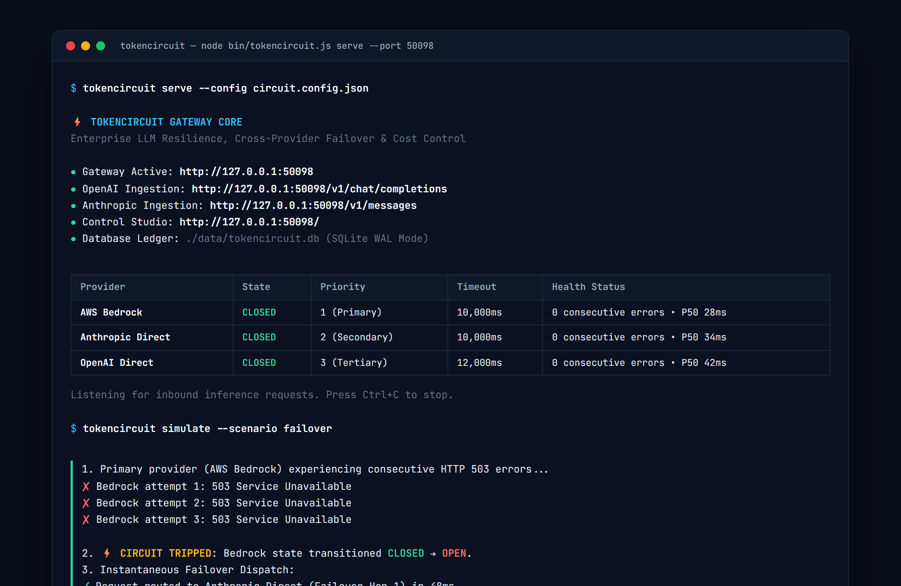

<p align="center">
  
</p>

<h1 align="center">TokenCircuit</h1>

<p align="center">
  <strong>Enterprise LLM Circuit Breaker, Multi-Provider Failover & Hard Budget Control Gateway</strong>
</p>

<p align="center">
  
  
  
  
  
  
</p>

---

TokenCircuit is a lightweight reverse proxy and visual control plane built in TypeScript and Node.js. It sits between application clients and upstream model providers to protect production services from API outages, rate limit cascades, runaway agent loops, and unexpected billing spikes.

<p align="center">
  
</p>

## Problem Space

Production systems integrating with proprietary LLM APIs face three recurring operational risks:

1. Provider Outages and Rate Limit Cascades: AI APIs experience periodic HTTP 500, 502, 503 errors and aggressive 429 rate limits. Without cross-provider failover, applications crash or hang.
2. Runaway Agent Loops: Autonomous workflows entering recursion or executing repetitive tool calls can consume substantial budgets within minutes. Most provider dashboards report spend with hours of delay.
3. Multi-Tenant Budget Overruns: Without strict per-tenant spend caps, a single test script can exhaust an organization's global token allocation.

## Architecture



* Three-State Circuit Breaker: Standard `CLOSED`, `OPEN`, and `HALF_OPEN` state transitions. Trips to `OPEN` on 3 consecutive 5xx/429 errors within 30 seconds. Bypasses failing providers in under 0.2ms without waiting for connection timeouts.
* Multi-Provider Failover Chains: Priority routing across AWS Bedrock, Anthropic Direct, and OpenAI. Normalizes request payloads and response envelopes in flight.
* SSE Streaming Failover Buffer: Buffers initial tokens during stream handshakes. If a primary provider drops connection before initial chunks emit, TokenCircuit transparently fails over to secondary models without severing client SSE streams.
* Hard Budget Enforcement: Daily and monthly dollar caps per tenant. Automatically downgrades models (e.g. Claude 3.5 Sonnet to Haiku) at 80% quota; cleanly rejects requests with HTTP 402 at 100%.
* Prompt and Token Cache: Content-addressed SQLite cache with configurable TTL and zero-cost hits, reducing token costs and latency for repetitive agent tool contexts.
* Tenant Sliding-Window Rate Limiter: Independent RPM and TPM rate limiters per tenant that emit HTTP 429 with standard `Retry-After` headers before upstream provider quotas trigger.
* Multi-Key Provider Vault: Dynamic round-robin API key pools per provider with automatic temporary cooldown on upstream 429 rate limit errors.
* Agent Loop Breaker: Uses sliding-window SHA-256 argument fingerprints to detect and terminate repetitive tool calls and ping-pong cycles before token exhaustion.
* Incident Webhook Dispatcher: Automated webhook dispatching to Slack, Discord, and incident receivers on circuit trips, budget exhaustion, or runaway loop terminations.
* OpenMetrics Prometheus Exporter: Native `/metrics` endpoint exporting circuit states, failover counters, tenant spend, and P95 latency metrics for Grafana dashboards.
* Embedded React 19 Control Studio: Dark mode interface displaying real-time circuit state toggles, tenant spend progress bars, interactive inference playground, failover stream, and an emergency global kill-switch.

---

## Control Studio Preview

### Live Dashboard & Metrics Ribbon
<p align="center">
  
</p>

### Multi-Device Responsive Design (Tablet & Mobile)
<p align="center">
  
  
</p>

### Circuit Breakers & Tenant Spend Meters
<p align="center">
  
  
</p>

### Live Failover Stream & Chaos Lab
<p align="center">
  
  
</p>

### Terminal CLI Execution
<p align="center">
  
</p>

---

## Quickstart

### 1. Installation

```bash
git clone https://github.com/alexandrmotologa/tokencircuit.git
cd tokencircuit
npm install
npm run build
```

### 2. Configure Environment

Copy `.env.example` to `.env`:

```bash
cp .env.example .env
```

Set your API keys:

```ini
PORT=50098
ANTHROPIC_API_KEY=sk-ant-api03-...
OPENAI_API_KEY=sk-proj-...
AWS_REGION=us-east-1
```

### 3. Start the Gateway & Studio

```bash
# Start the proxy server and embedded Web Studio
node bin/tokencircuit.js serve --port 50098
```

The gateway listens at `http://127.0.0.1:50098`. Open `http://localhost:50098` in your browser to access the Control Studio.

---

## Client Integration

TokenCircuit acts as a transparent reverse proxy. Update your client's base URL to route through the gateway.

### Using OpenAI Python SDK

```python
from openai import OpenAI

client = OpenAI(
    base_url="http://localhost:50098/v1",
    api_key="sk-dummy-or-real",
    default_headers={"x-tenant-id": "analytics-pipeline"}
)

response = client.chat.completions.create(
    model="gpt-4o",
    messages=[{"role": "user", "content": "Analyze system latency logs"}]
)

print(response.choices[0].message.content)
```

### Using Anthropic Python SDK

```python
import anthropic

client = anthropic.Anthropic(
    base_url="http://localhost:50098",
    api_key="sk-dummy-or-real",
    default_headers={"x-tenant-id": "research-swarm"}
)

message = client.messages.create(
    model="claude-3-5-sonnet-20241022",
    max_tokens=1024,
    messages=[{"role": "user", "content": "Summarize transaction batches"}]
)

print(message.content[0].text)
```

---

## Diagnostic Response Headers

Every routed response includes TokenCircuit diagnostic headers:

| Header | Description | Example |
| :--- | :--- | :--- |
| `x-tokencircuit-id` | Unique gateway request identifier | `tc_1792084656_a8d3f` |
| `x-tokencircuit-provider` | Upstream provider that answered | `anthropic` |
| `x-tokencircuit-model` | Model executed (including downgrades) | `claude-3-5-haiku-20241022` |
| `x-tokencircuit-cost-usd` | Microdollar cost calculation | `0.004720` |
| `x-tokencircuit-failover` | Indicates whether failover occurred | `true` |
| `x-tokencircuit-hops` | Number of failed upstream attempts | `1` |
| `x-tokencircuit-downgraded` | Indicates whether model was downgraded | `true` |

---

## CLI Reference

TokenCircuit includes a command-line interface for administration:

```bash
# Start gateway server
tokencircuit serve --port 50098 --config circuit.config.json

# List tenant spend and quota statuses
tokencircuit budget list

# Set tenant caps and downgrade target
tokencircuit budget set engineering-team --daily 50.0 --monthly 500.0 --auto-downgrade true

# View circuit statuses and latencies
tokencircuit circuit status

# Force trip or reset a circuit
tokencircuit circuit trip bedrock --reason "Scheduled AWS maintenance"
tokencircuit circuit reset bedrock

# Run automated chaos drills
tokencircuit simulate --scenario failover
tokencircuit simulate --scenario loop
tokencircuit simulate --scenario budget
```

---

## Latency Benchmarks

Measured on Node.js 24 LTS and Fastify 5.x:

| Metric | Measured Value |
| :--- | :--- |
| Gateway Routing Overhead | 0.85 ms (p50) / 1.42 ms (p95) |
| Tripped Circuit Short-Circuit Latency | 0.15 ms |
| Cross-Provider Payload Translation | 0.42 ms |
| SQLite WAL Ledger Write Latency | 0.28 ms |
| Memory Footprint (Baseline) | 42 MB RSS |

For detailed performance data, see [docs/BENCHMARKS.md](docs/BENCHMARKS.md).

---

## Documentation

* [System Architecture & Lifecycle](docs/ARCHITECTURE.md)
* [Performance & Latency Benchmarks](docs/BENCHMARKS.md)
* [Complete API Reference](docs/API_REFERENCE.md)

---

## License

MIT &copy; [Alexandr Motologa](https://github.com/alexandrmotologa)
