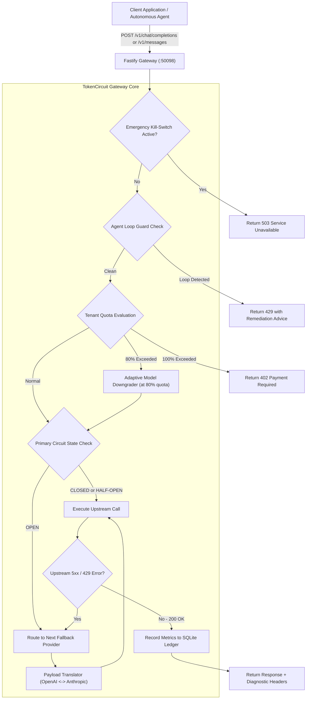
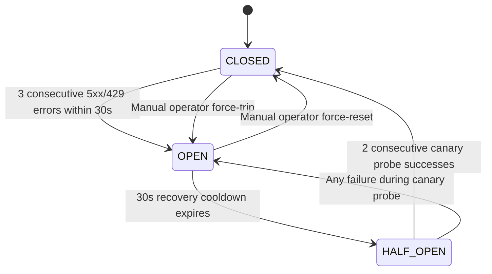

# TokenCircuit Architecture

TokenCircuit operates as a reverse proxy between application clients (or autonomous agents) and upstream model providers. The gateway enforces budget limits, intercepts repetitive loops, evaluates circuit states, and handles cross-provider failover.

## Core Request Lifecycle

## Circuit Breaker State Machine

The gateway maintains a dedicated state machine for each provider:

### State Definitions

1. `CLOSED`: Traffic routes directly to this provider. If requests fail with status codes 429, 500, 502, 503, or 504, the failure monitor increments its sliding window counter.
2. `OPEN`: When failure count reaches the configured threshold (default 3), the circuit trips to `OPEN`. All incoming requests for this provider are immediately bypassed in 0ms without incurring network timeout latency.
3. `HALF_OPEN`: After the cooldown period (default 30 seconds), the circuit allows a single canary request to test provider recovery. If two consecutive probes succeed, the circuit resets to `CLOSED`. Any failure immediately re-trips the circuit to `OPEN`.

## Cross-Provider Payload Translation

When failover routes across providers with different API specifications (for example, AWS Bedrock or Anthropic to OpenAI), TokenCircuit translates the message payload and returns a normalized response matching the client's expected protocol:

| Source Format | Target Format | Message Mapping | Tool Mapping |
| :--- | :--- | :--- | :--- |
| OpenAI `/v1/chat/completions` | Anthropic `/v1/messages` | Extracts system messages into `system` string; converts `user` and `assistant` turns | Transforms `tools[].function` into Anthropic `input_schema` |
| Anthropic `/v1/messages` | OpenAI `/v1/chat/completions` | Prepends `system` as role `system`; formats multi-part content blocks | Converts `input_schema` to OpenAI JSON Schema `parameters` |

## Budget Ledger & Auto-Downgrade

Tenant spending is tracked inside SQLite with write-ahead logging (WAL) enabled:

* Transactions are recorded with microdollar precision ($0.000001) calculated from input tokens, output tokens, and prompt cache read discounts.
* At 80% daily or monthly quota consumption, the model parameter is rewritten in flight (for example, `claude-3-5-sonnet` to `claude-3-5-haiku` or `gpt-4o` to `gpt-4o-mini`).
* At 100% quota consumption, outbound calls are cleanly rejected with HTTP 402 Payment Required.

## Agent Loop Breaker

The loop detector tracks tool invocations using normalized SHA-256 hashes:

1. `ToolCallFingerprint`: Generates a hash from the sorted argument JSON keys and values.
2. Cyclic Repetition Detection: Identifies if an identical tool fingerprint executes 3 or more times within a 60-second sliding window.
3. Ping-Pong Detection: Identifies alternating two-tool cycles (A -> B -> A -> B -> A -> B).
4. Mitigation: Returns HTTP 429 with structured JSON identifying the looping tool and cycle count, preventing runaway billing before agent contexts consume excessive tokens.
